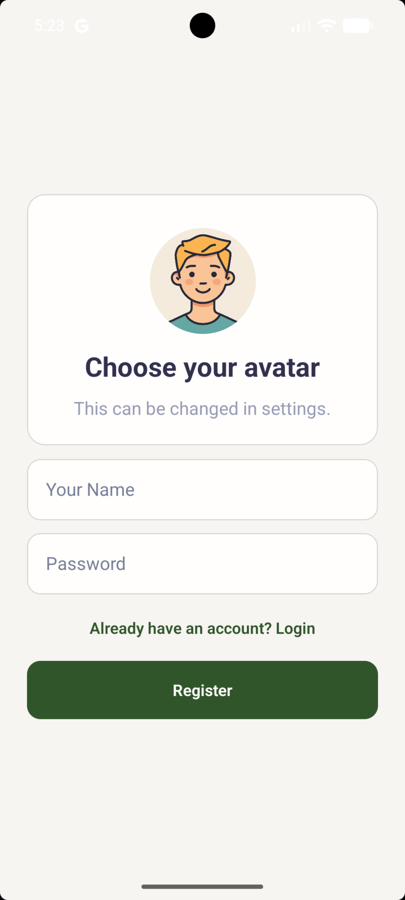
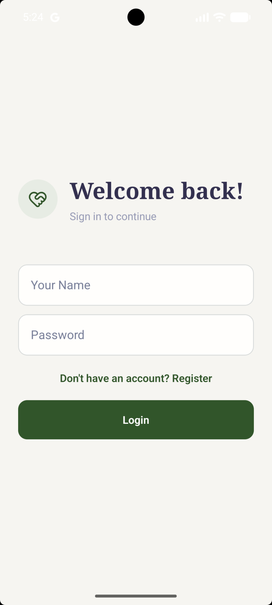
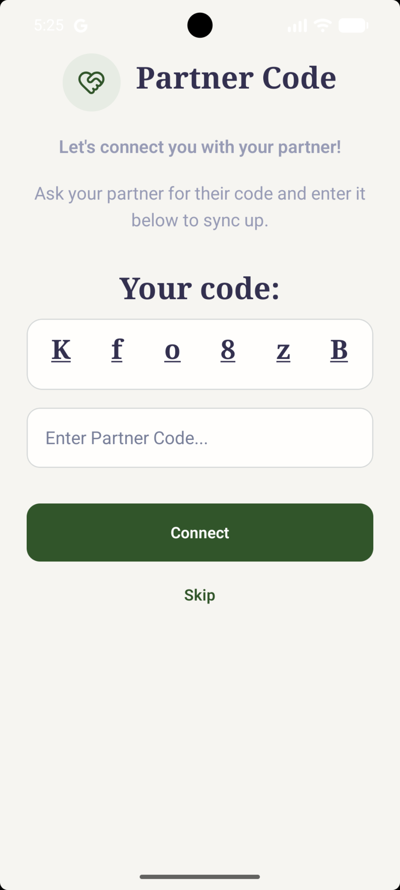
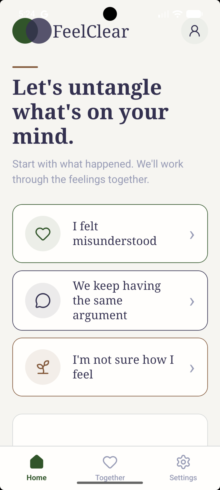
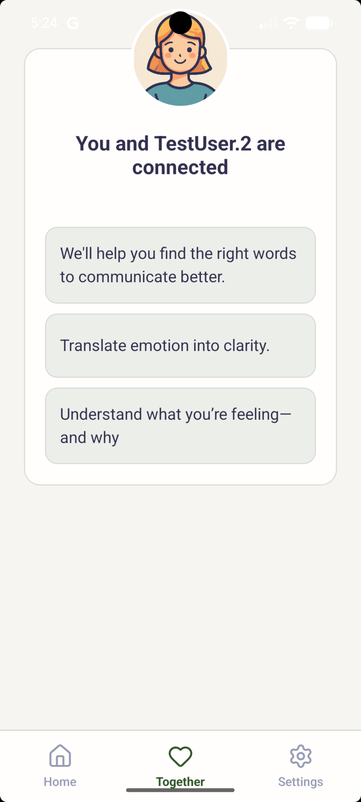
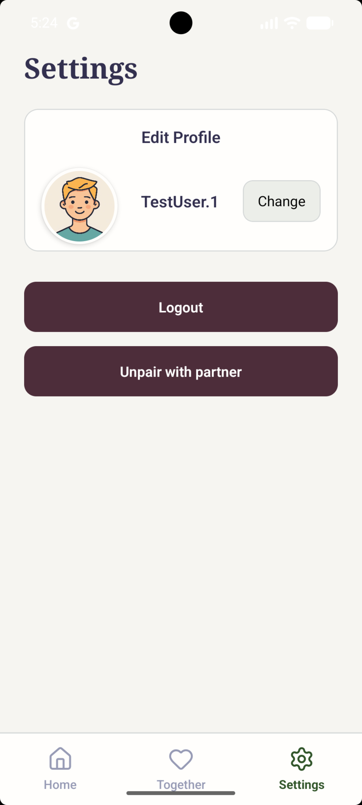

# FeelClear

  

FeelClear is a relationship-focused reflection app that helps you make sense of what you're feeling and find clearer words for difficult conversations. Share what is on your mind and receive an AI-guided response to help you reflect.

## What you can do

- **Reflect on your feelings:** Write about what happened or start with a prompt such as feeling misunderstood, repeating an argument, or not knowing how you feel.
- **Get guided responses:** FeelClear responds to your reflection with supportive guidance to help you explore your feelings.
- **Connect with a partner:** Link accounts using a partner code to see your connection in the app. You can also skip pairing.
- **Manage your profile:** Choose or update your avatar and name, and manage your account or partner connection in Settings.

FeelClear is a reflection and communication aid, not a replacement for professional mental health care.

## Screenshots

| Create an account | Sign in | Connect with a partner |
|---|---|---|
|  |  |  |

| Reflect on the home screen | View your partner connection | Manage your profile and settings |
|---|---|---|
|  |  |  |
